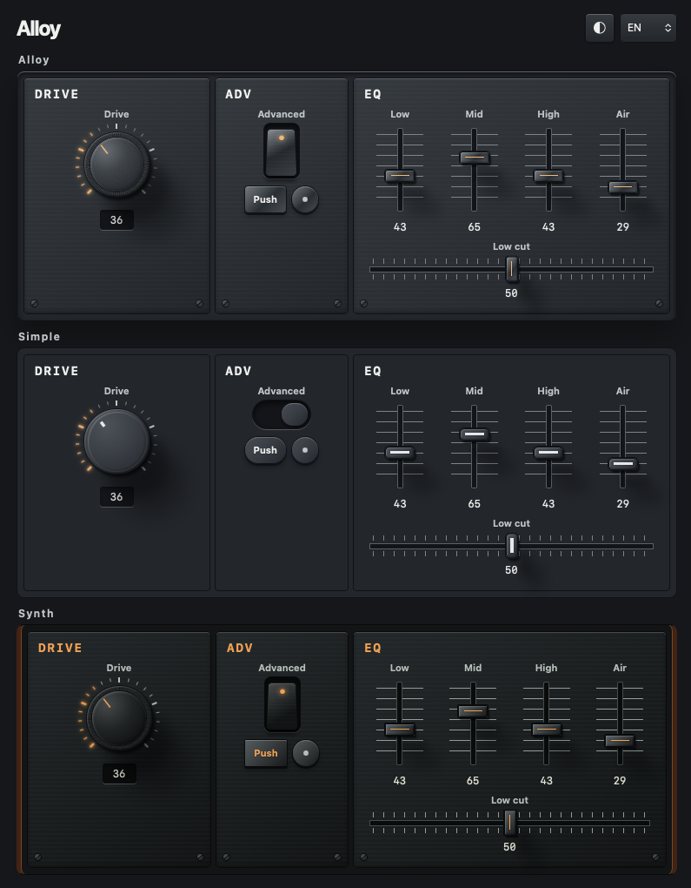

# web-components3D Interface Kit



`sample/` の DRIVE、ADV、EQ をもとにした Tauri 2 + Rust 用の操作部品です。黒と白の金属仕上げ、英語・日本語・简体中文のデモを収録しています。

## 起動

Rust と対象 OS の Tauri 2 ビルド環境が必要です。リポジトリのルートで実行します。

```sh
cargo run --locked --manifest-path src-tauri/Cargo.toml
```

ブラウザだけで部品を試す場合は `python3 -m http.server 8765 --directory ui` を実行し、`http://localhost:8765` を開きます。

## サンプルデザイン

ブラウザで `http://localhost:8765/?view=samples` を開くと、`sample/` の元デザイン全12種を選んで操作できます。プレビュー内の操作値は各サンプルのデモ用です。元の Three.js 描画は CDN を使い、読み込めない場合はサンプルの CSS 表示に切り替わります。

## 組み込み

`ui/alloy.css` と `ui/controls.js` を既存の WebView に配置します。CSS のカスタムプロパティで色や仕上げを変更できます。初期値とラベルは属性で指定し、接続後は `value` と `label` プロパティで更新します。

```html
<link rel="stylesheet" href="alloy.css">
<script type="module" src="controls.js"></script>

<alloy-knob label="Drive" value="36" data-size="small"></alloy-knob>
<alloy-switch label="Advanced" value="true"></alloy-switch>
<alloy-fader label="Low" value="43" data-axis="vertical"></alloy-fader>
<alloy-fader label="Low cut" value="50" data-axis="horizontal"></alloy-fader>
```

- ノブは標準、`small`、`nano` の3サイズ。上下ドラッグまたは矢印キーで操作し、Shiftを押しながらドラッグすると微調整できます。
- ノブとフェーダーは 0–100 の数値、スイッチは真偽値です。各要素の `input` イベントで `event.currentTarget.value` を読み取れます。
- ルート要素の `data-theme="white"` で白仕上げに切り替わります。

Rust の `Document` が正本です。WebView は `snapshot` で初期状態を読み、`update` で値を変更し、`rack-change` を購読します。値は起動中のメモリに保持します。

金属面や照明は WebView の CSS で描画しています。IPC は操作と状態の JSON のみです。音声処理を組み込む場合は、これらの値を Rust 側で実際の DSP パラメータに割り当てます。

## シンプル版

親コンテナに `data-variant="simple"` を指定すると、同じ部品を元のサンプルに近い滑らかな仕上げで表示できます。デモでは Alloy 版とシンプル版を同じページに並べ、白黒と言語を共有しています。操作値は版ごとに独立しています。

## コンパクト配置

親コンテナまたは個々の部品に `data-density="compact"` を指定すると、操作部と内部の間隔が詰まります。外側の間隔は組み込み先の Grid や Flex の `gap` で指定します。

```html
<div data-density="compact" style="display: grid; grid-template-columns: 60px 44px; gap: 4px">
  <alloy-knob label="Drive" value="36" data-size="nano" data-readout="hidden"></alloy-knob>
  <alloy-switch label="Advanced" value="true" data-label="hidden"></alloy-switch>
</div>
```

`data-label="hidden"` を指定しても、ラベルは支援技術で読み上げられます。寸法を個別に調整するには `--alloy-knob-size`、`--alloy-switch-width`、`--alloy-switch-height`、`--alloy-fader-height`、`--alloy-gap` を指定します。

## プッシュボタン

`<alloy-push-button label="Push"></alloy-push-button>` を配置し、要素の `click` イベントに処理を登録します。マウスやタッチのほか、フォーカス中の Space または Enter で押せます。

正円のボタンは `<alloy-push-button data-shape="round" label="Round push button"></alloy-push-button>` で表示できます。ラベルはツールチップと読み上げに使います。
